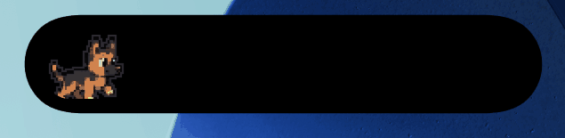
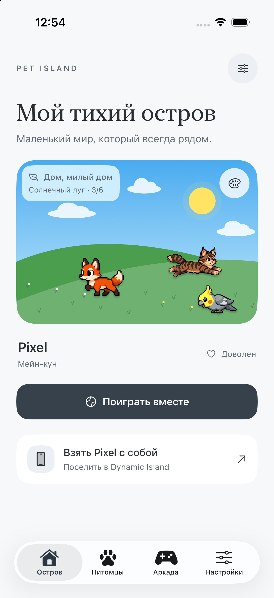
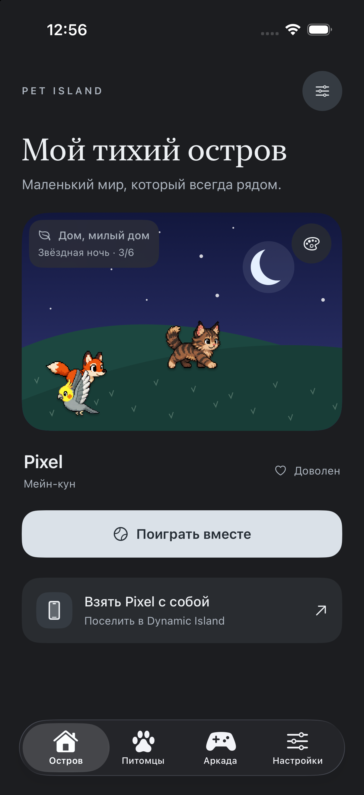
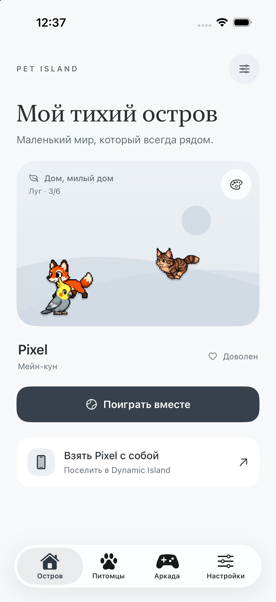
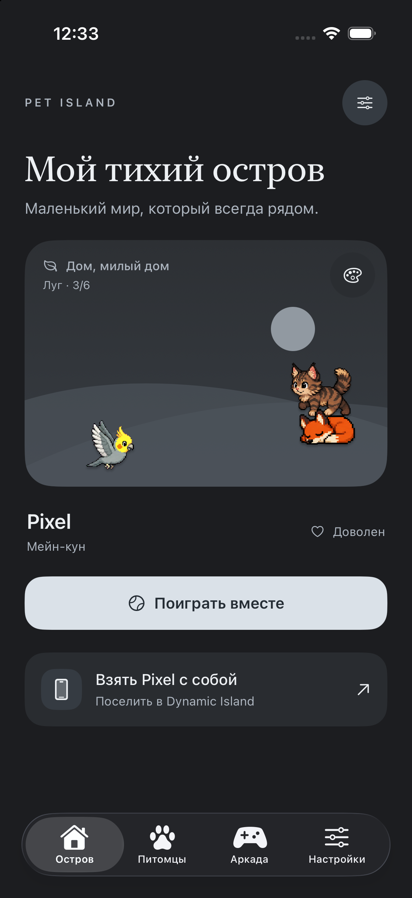
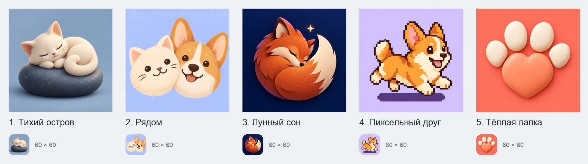

# Pet Island

Pet Island is an independent personal iOS project: a small island for pixel
companions, with an interactive enclosure, discovery walks, four arcade games,
a Home Screen widget, and a pet that accompanies you in Dynamic Island and on
the Lock Screen.

The app works locally, without an account, a backend, analytics, or advertising.
The interface is available in English and Russian.

> **Status: active development, ready for iPhone testing.** The latest verified
> build passed 355 tests (345 unit and 10 UI tests), a Release build, and static analysis on October 10,
> 2026. Simulator checks cover the main flows; physical-device and accessibility
> testing are still part of the work before a public release.

<p align="center">
  
</p>

<p align="center"><sub>Dynamic Island footage recorded in the iOS Simulator.</sub></p>

## Pets and their island

The collection contains **20 visual variants across six species**:

| Species | Available variants |
| --- | --- |
| Dogs | German shepherd, Pembroke corgi, Cardigan corgi, Doberman, bull terrier |
| Cats | Classic cat, British shorthair, Maine coon, Siamese |
| Foxes | Red fox, arctic fox |
| Parrots | Classic parrot, cockatiel, budgie, macaw |
| Penguins | Classic penguin, rockhopper |
| Lions | Adult male lion, lioness, lion cub |

- Give pets names, choose their variants and coats, or set a custom color.
- The Corgi card offers Pembroke and Cardigan variants, followed by the same
  text-based coat selector used for other pets.
- Keep up to **six residents** in the enclosure and choose from **ten scenes**:
  five calm environments and five vivid alternatives, including a sunny meadow,
  a starry night, a warm room, a snowy cove, and sunset dunes.
- Pet your companions and open the full-screen playroom to throw a ball and
  play fetch. Grounded movement and gait frames follow the distance travelled.
- Track fullness, happiness, and energy, with rest and care between games.
- Tap a companion in **Pets** to open its personal card: current location,
  fullness, happiness, energy, care supplies, wardrobe, and walk memories.
  Giving an item uses the existing shared inventory and only affects that pet.
  Empty supplies, unnecessary care, and care during a walk stay unavailable.
- The card opens the shop and walk picker with that companion selected.
  Memories belong to the pet's identity and survive renaming. Editing the name
  or appearance remains a separate pencil action; the original artwork is reused.
- Open **Enclosure → Furniture**, tap an owned item and choose its place. Placement
  saves immediately and shows a checkmark; no separate enclosure save is needed.
  Tap a placed item to remove it, or use its **Move item** context menu.
- The layout has **two ground places and one upper perch**, leaving the middle
  open for walking. Only one bulky item (a box or leaf nest) can be placed at once.
  Replacing an item returns it to the collection without another charge.
- Buy furniture once with earned coins in **Arcade → Shop**:

  | Item | Coins | Interaction |
  | --- | ---: | --- |
  | Cozy box | 80 | Cats peek out or nap inside |
  | Soft bed | 65 | Dogs settle down to sleep |
  | Leaf nest | 90 | Foxes rustle leaves, then rest |
  | Little swing | 100 | Parrots land and sway gently |
  | Splash pool | 110 | Penguins play with ripples and splashes |
  | Warm stone | 95 | Lions rest; cubs can play before sleeping |
  | Play ball | 45 | Cats, dogs, foxes and lions play beside the ball |

- Nearby pets can visit suitable furniture by themselves. Tap an item to invite
  a pet, or tap its occupant to let it leave. A pet reserves its item throughout
  approach, entry, use and exit, so two pets cannot occupy it simultaneously.
- Existing boxes remain owned without a charge. All animal artwork and sprite
  frames are preserved. The Home Screen widget reflects the placed furniture.

<p align="center">
  
  
</p>

## Friendship and little habits

Open **Pets → your pet → Your friendship** (**Ваша дружба**) to share a free
quiet moment. Each companion has its own lasting friendship, from getting
acquainted to becoming inseparable. Attention, useful care inside the app, and
finishing an arcade game with a positive score each add one moment per local
calendar day. Repeated taps and failed saves add nothing. There is no streak,
decay, coin cost, or penalty for time away; pets on a walk can be greeted after
they return. This progression does not change vitals, art, gaits or DI behaviour.

**Little habits** stays collapsed until opened. It reveals familiar care, games
and walking routes from actual shared activities. Care and games count the first
successful choice of each day; routes use that pet's collected walk memories.
A favourite needs at least three repeats and a clear lead over other choices.
Habits are descriptive and do not make other food or activities less useful.

Friendship follows the pet's identity through renames, restarts and island backups.
Older saves start with no friendship history; existing walk memories remain
available for familiar paths. Old backup files still open. New copies use format
version 2 so an older app cannot silently discard the new progress on import.
The feature adds no background work, animation loop or separate timer.

## Accessories and wardrobe

Open **Pets → your pet → Wardrobe**, or use the **… → Wardrobe** shortcut on
its tile. Accessories are also available in **Arcade → Shop → Accessories**.
Try an accessory before buying and preview it while standing, walking, running,
or resting. Choose **Buy**, then **Wear accessory**; closing the preview does not
change the pet. Choose **No accessory → Remove accessory** to take it off.
The purchase/apply button stays at the bottom while the wardrobe scrolls,
including when using larger system text. Walking/running previews sample at
30 Hz so short run frames are not skipped; the preview pauses when scrolled out
of view, in the background, or with Reduce Motion enabled.

| Accessory | Coins |
| --- | ---: |
| Cloud beanie | 70 |
| Little crown | 110 |
| Berry bow | 50 |

Each purchase is permanent and reusable across all 20 pet variants, including
several pets at once. A pet wears one head accessory at a time. Outfits persist
across launches and appear in the enclosure, playroom, walks, arcades, Home Screen
widget, Lock Screen and Dynamic Island. Pets away on a discovery walk can change
their outfit after returning.

Each accessory uses **441 complete redrawn outfit frames** for all 20 pet variants
(**1,323 frames** across the beanie, crown and bow),
including every walking, running, flying, playing, jumping and sleeping frame.
The hat wraps the head and hides the ears; it is part of each alternate sprite.
Original artwork without accessories and movement timing remain unchanged.
Crowns sit between the ears; bows follow the side of the head. Their perspective
and contact with the fur are authored for each pose, including sleep.

The app, widget and Live Activities use the same authored outfit frames and
original canvas registration. Matching timer fonts replace the bare pet in
Dynamic Island and on the Lock Screen; a colour-preservation mask keeps each accessory’s
original colours with custom coats. The original coat uses the completed sprite
directly, without drawing a second, identical accessory layer.

Timer fonts live only in the widget/Live Activity extension, in **60 small
collections** split by breed and accessory. A collection is registered on first
use and contains 24 faces for both surfaces and all six movement modes. Successful
lookups are cached; pets without accessories do not load these collections.
The app and widget retain their own outfit PNGs for foreground and snapshot
rendering. Cached images and lossless duplicate glyph references avoid an added
background animation loop. These are earned in-game coins, not real-money purchases.

## Walks and finds

Tap the **compass on Island** to open walks and the finds album in a separate
sheet. Choose a pet and one of three paths:
the quiet garden (20 minutes), the seashore (40 minutes), or the little grove
(60 minutes). Each path has four collectible finds, for **12 finds** in total.

One pet can explore at a time. It leaves the enclosure while its place stays
reserved, and returns automatically at the end of the walk. During the walk it
cannot join Dynamic Island or start an arcade game. Bring a pet home from
Dynamic Island before sending it exploring. Ending a walk early brings it home
without a find.

Walks continue while the app is closed. A ready find waits until you collect
it, with no missed-day penalty. The **Finds album** saves each discovery with
its pet, date, and a short story that can be shared as text. Progress stays on
the device and survives app restarts. Walks do not change pet artwork,
existing animation assets, care, or coins.

The active walk now shows its own landscape inside the walks sheet: a garden with
flowers and bushes, a shore with pebbles and reeds, or a grove with roots, mushrooms
and a fallen branch. The companion follows paths, pauses to investigate landmarks,
and heads home before the saved return time. Movement uses the existing natural
gait sprites, paced by distance, and restores from the saved walk when reopened.

Walks use a saved deadline, with no background polling. Their visible countdown
updates once a minute. The scene animates only while visible and uncovered, pauses
outside the scroll viewport or behind the album, and respects Reduce Motion. Once
the pet has returned, the landscape stays still and shows that it is home. Empty
enclosures stop the display-link animation loop.
Animations pause when the app becomes inactive. Actual battery and thermal
behaviour still needs measurement on a physical iPhone.

Foreground movement targets up to 60 Hz in the enclosure, playroom and walks.
Sprite resolution and static scenery are reused between pose changes; moving
coordinates do not require rebuilding the same artwork. Resting enclosure pets
keep their behaviour timers without publishing identical pictures every frame.
The enclosure also pauses outside the scroll viewport and on other tabs.
The playroom restores its 60 Hz target after Reduce Motion is switched off.
These changes preserve the approved sprite pixels, gait sequences and system
animation timing in Dynamic Island and on the Lock Screen.

The compass gains a small dot when a find is ready. In Russian, open
**Остров → компас «Прогулки» → Альбом находок**.

Furniture interactions run on the enclosure's existing animation loop, with no
extra timers or background tasks. Reduced motion keeps them static and still
lets you invite a pet. The home enclosure pauses while walks, its editor, island setup,
or the playroom cover it.

## Arcade

Four games share your pet collection and local progress:

| Game | Play |
| --- | --- |
| Bubble Paws (Пузырьки) | Aim a toy cannon, match three connected bubbles, and drop unsupported clusters |
| Pets Dash | Run along an island trail, change lanes, jump over obstacles, and collect coins |
| Sky Paws | Flap through gaps between clouds |
| Sky Hop | Jump between floating platforms and climb higher |

**Bubble Paws** has five increasingly difficult rounds in a twilight clearing.
Six shuffled field silhouettes, random gaps, and fresh color layouts keep new runs
varied; adjacent rounds never reuse the same silhouette. Small color clusters
require building pairs and planning bank shots, with four colors initially and
five from the second round.
Drag to aim and release to shoot; the dotted guide follows the same wall bounces
as the actual shot. Tap the next bubble to swap colors, or use the left/right
and Shoot buttons. Five shots without a match lower the ceiling (four from round
three); successful matches do not reset that counter. Reaching the dotted danger
line ends the run. Clear all five rounds to win.
Each color also has its own symbol. Scores and earned coins use the existing
arcade wallet, with duplicate reward protection. Animation runs only during
shots and effects. Each pet keeps its own unfinished game: the field, score,
round, next colors, and remaining level shuffle survive closing the app. A shot's
result is saved before its animation starts; reopening during a shot resumes after
that shot, without repeating it. The arcade card shows **Continue game**, and the
restored game waits on pause. A new game requires confirmation before replacing
an unfinished one. Failed writes leave the previous turn intact, and a finished
but unclaimed reward can be retried after reopening.

Games include records, coin rewards, pause/resume, and a local shop with enclosure
furniture, food, treats, toys, and vitamins. The shop uses earned in-game coins; it does not make
real-money purchases. Backgrounding a game pauses the action.
Food, treats, toys, and vitamins are only consumed when they improve at least one
of the pet's needs. Giving items waits until the pet returns from a walk; buying
supplies remains available. The shop explains unavailable actions. Repeated taps
and failed saves do not spend extra items.

## Appearance

The **Quiet Island** interface has a graphite dark theme, a gentle light theme,
and a system-following option. Haptics and reduced pet motion are configurable.

<p align="center">
  
  
</p>

The original app icon remains the default. **Settings → App icon** offers it
alongside five alternatives: Quiet Island, Together, Moon nap, Pixel friend,
and Warm paw. Selecting one changes the actual Home Screen icon; the original
can be restored at any time.

<p align="center">
  
</p>

## Island backups

Open **Settings → Island backup** (**Настройки → Копия острова**) to save one
JSON file through the system Files picker. It includes pets and their outfits,
coins, supplies, purchases, friendship, habits, enclosure layout, settings, finds, the current walk,
records and unfinished Bubble Paws games. Keep the exported file outside the app
to transfer the island to another device or recover after reinstalling.

**Open a backup** validates the format, size, checksum and save data, then shows
the pets and inventory before asking to replace the island. Import replaces the
whole save; it does not add coins or merge collections. Before writing, the app
saves an automatic return copy, available as **Island before last restore**.
If writing fails or the process stops midway, a durable journal restores the
previous island before normal loading resumes.

Bring a pet home from Dynamic Island before importing. Live Activity sessions
and the system app icon are not transferred. A saved discovery walk keeps its
original return time. Export is manual; there are no scheduled uploads or new
background timers. The import limit is 12 MiB.

## Dynamic Island and Lock Screen

Take one pet from the island with you in a Live Activity. The compact and
minimal Dynamic Island presentations show the pet; the expanded presentation
also provides short run and play interactions.

In **Island → Island setup** you can choose:

- **Pet mode:** run, walk, sleep, run + sleep, walk + sleep, or run + walk + sleep.
- **Time on the island:** 20 minutes, 40 minutes, 1 hour, 2 hours, or 4 hours.
- **Card color:** five presets or any custom color, with a preview and a reset
  to the default background. Text contrast adjusts automatically.

Saving a card color updates the current Live Activity and future sessions.
Changing the movement mode or duration takes effect on the next session.
The card color applies to the **Lock Screen only**: Dynamic Island has no added
colored outline. On an iPhone without Dynamic Island, the Live Activity is
still available on the Lock Screen.

The system presentations use registered pet artwork and timer fonts with
consistent sizing and ground alignment. iOS controls their rendering and update
opportunities; they do not run the app's continuous animation loop. The pet
rests when the activity becomes stale or the display enters its reduced-luminance
Always-On state.

## Home Screen widget

The medium enclosure widget shares residents, background, and care state with
the app through an App Group. It displays timeline snapshots and short care
reactions. **Play** opens the interactive playroom in the app.

To add it, launch Pet Island once, choose enclosure residents, then open the
Home Screen widget gallery and select **Pet Island → Enclosure**. The app cannot
place a widget on the Home Screen automatically.

## Build and run

### Requirements

- macOS and Xcode with an installed iOS Simulator runtime.
- iOS **17.0 or later**; current simulator verification uses **iOS 27.0**.
- A compatible iPhone or simulator for Dynamic Island testing, and a physical
  iPhone with Always-On Display to verify that behaviour on hardware.
- No external package dependencies are required to build the iOS app.

### Xcode

1. Open `PetIsland.xcodeproj` and select the **PetIsland** scheme.
2. Choose an iPhone simulator, or connect an iPhone and select it as the destination.
3. For a physical device, select your development team under **Signing &
   Capabilities** for both `PetIsland` and `PetIslandLiveActivity`.
4. Confirm that both targets have access to the same App Group.
5. Run with **Command-R**.

The project currently uses these identifiers:

| Target / capability | Identifier |
| --- | --- |
| Main app | `org.bortongo.PetIsland` |
| Widget and Live Activity extension | `org.bortongo.PetIsland.LiveActivity` |
| Shared App Group | `group.org.bortongo.PetIsland` |

If signing with another team, use identifiers available to that team. Update
the App Group in both entitlement files and in
`PetIsland/Shared/PetLifeState.swift` together.

The main app embeds the extension. Run the **PetIsland** scheme for normal
testing; launching the extension scheme directly opens a widget preview flow.

## Check the current features on iPhone

1. Add pets, switch between the two corgi variants, and try coats and custom colors.
2. Change the enclosure residents and scene; open the playroom and throw the ball.
3. Start each arcade, pause it, background the app, and return to the game.
4. Take a pet to Dynamic Island, inspect the compact and expanded views, and
   check the Lock Screen with the display awake and in Always-On mode.
5. Open **Island → Island setup → Card color**, save a light or dark color, and
   verify the active Lock Screen card. Try resetting it to the default.
6. Open **Settings → App icon**, choose an alternative, check it on the Home
   Screen, and switch back to the original.
7. Add the enclosure widget and check that resident and scene changes reach it.
8. Start a discovery walk, close and reopen the app, and check that the pet
   stays away until its return time. Collect its find, open the album, and
   try ending another walk early.
9. Save an island backup in Files, open it to review its contents, and cancel.
   When ready to test restoration, confirm replacement and check the pets,
   supplies, furniture, album and saved game. The automatic return copy remains
   available in the same settings screen.

In Russian, the new settings are **Остров → Настройка острова → Цвет карточки**
and **Настройки → Иконка приложения**.

## Foreground performance

The enclosure, walking scene, and playroom normally target 60 frames per second.
Low Power Mode or a serious/critical thermal state switches these foreground
scenes to 30 FPS; returning to normal restores 60 FPS. Simulation time and
stride distance do not change, so pets do not slow down or reset their poses.
The system's Reduce Motion preference still takes precedence. Arcade gameplay,
Dynamic Island, and Lock Screen rendering keep their existing behavior.

One shared observer listens to system power/thermal notifications and refreshes
when the app becomes active. It adds no polling or background timer. Hidden
scenes remain stopped when the power state changes. Frame-rate requests follow
[Apple's display-link guidance](https://developer.apple.com/documentation/quartzcore/cadisplaylink/preferredframeraterange);
the actual refresh rate is controlled by iOS.

Invisible simulation bookkeeping no longer invalidates the playroom or resting
furniture. In a deterministic 120-tick simulator check, an idle playroom went
from 120 view updates to 5; a pet on a soft bed went from 123 to 3, and on a warm
stone from 122 to 2. The remaining updates match actual visible changes. Flying
birds, animated furniture, and ball interactions continue to publish their frames.
These counts measure avoided UI updates, **not battery savings**. Two 30-second
physical iPhone 17 Pro checks on iOS 27.0.1 covered a playroom ball return with
five pets and the saved island with five residents, a box, and a bed. Instruments
reported a nominal thermal state throughout both recordings. Peak process
footprints were about 80 MiB and 85 MiB respectively. These were optimized debug
builds on USB power; longer unplugged battery and frame-pacing measurements
remain pending.

## Tests and validation

The **PetIslandUITests** target exercises the collection-to-card flow, care stock
updates, per-pet friendship and large-text habits, the selected companion in the shop and walks, return/collection, backup
export/import through Files, restore confirmation and cancellation, and large text
layouts. These tests use in-memory fixtures and run only in Simulator.
Their screenshots are attached to the Xcode test results.

Run the **PetIsland** test action with **Command-U** in Xcode. The latest verified
suite covers save recovery, full-island backup validation, interrupted restore
rollback, return copies, repeated import without duplicated coins or pets, pet placement, arcade
rules, per-pet Bubble Paws recovery, interrupted shots, care availability and
repeated taps, movement geometry, sprite registration, Live Activity color persistence
and contrast, alternate-icon configuration, discovery persistence, automatic
returns, exclusion between walks and Live Activities, accessory ownership, failed
purchases, outfit persistence, complete outfit coverage, original canvas sizes,
mirrored timer/PNG registration, and rendered silhouettes without bare ears.

For the full automated check, install the Python tooling dependencies and run:

```sh
python3 -m venv .venv
. .venv/bin/activate
python -m pip install -r Tools/requirements-dev.txt
bash Tools/check_project.sh
```

The script validates timer fonts, complete outfit frames and colour masks, natural gaits,
and the bundled lion/Cardigan frames;
then runs the simulator tests, a Release build, and static analysis. Reports go
to `outputs/qa/`. Set `PET_TEST_DESTINATION` to select a particular simulator,
`PET_PYTHON` to choose a Python interpreter, or `PET_REPORT_DIR` to choose a new
report directory. Pillow and fontTools are development-only dependencies.

These checks use only committed application resources and do not require artwork
drafts or generation tools. Automated and simulator checks do not replace
physical-device coverage, complete VoiceOver and Dynamic Type checks,
minimum-supported-iOS testing, or performance measurements.

For an isolated simulator benchmark, run
`PetAccessoryTests/testAccessoryColdStartRecordsTimeAndMemory` in a fresh test
host. It records the first outfit font lookup's wall time, CPU time and memory
footprint. `testAccessorySixPetRenderingPerformance` measures 12 offscreen gait
phases for six dressed pets. Compare the same simulator and build configuration;
these measurements do not estimate iPhone battery life or display frame rate.
Set `PET_DERIVED_DATA` and `PET_RELEASE_DERIVED_DATA` when running the check script
to verify packaging in fresh build directories.

## Project structure

```text
PetIsland/
  App/                     App lifecycle and session controller
  Data/                    Local saves and recovery
  Domain/                  Pet, care, and arcade rules
  Features/                Island, collection, playroom, games, and settings
  Shared/                  Shared models, artwork, and Live Activity payloads
  Assets.xcassets/         App assets, default and alternate icons
PetIslandLiveActivity/     Home Screen widget and Live Activity extension
PetIslandTests/            Automated tests
SharedResources/          Sprite catalog shared with the extension
Docs/Media/               Screenshots and illustrations used by the README
Tools/                    Resource validation and automated build checks
```

## Further development

The next focus is device testing and polishing the existing pet, enclosure, and
arcade experience. Richer discoveries, illustrated postcards, shared pet scenes
and a future way to support the author are ideas for later, not current features.

## License

The project's source code is licensed under the [MIT License](LICENSE).
